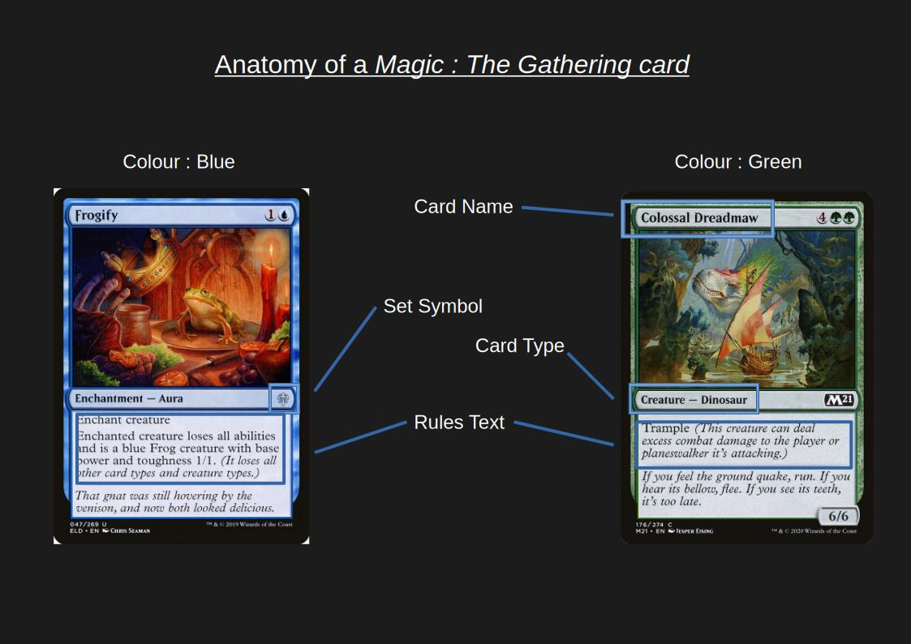
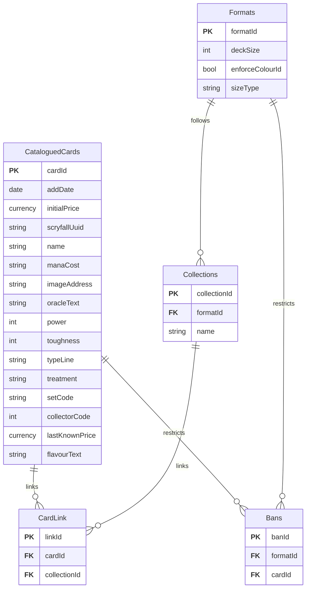

# Codex
***Important disclaimers:***

***While our project is based around a specific collectible product, none of the functionalities rely on knowledge of Magic: The Gathering to be understood. We have included a small amount of information about the game to make our solution easier to visualize, but no understanding is required to appreciate the features of the app.***

***Magic: The Gathering is a brand owned by the company Wizards of The Coast, however they encourge community projects based off of their IPs, as long as these projects remain respectful and free.***
## Project Goals
Codex is a collection management software focused on the trading card game *Magic: The Gathering*. Collections of cards for this game can often be large, and there are over 800 000 unique cards, so most collectors need software to categorize and  search their collections. We intend to create a simple to use app that allows users to keep an updated list of the cards they own and the cards that they want, and organize them according to their own preferences, so that it is helpful to any *Magic*  player. The intended impact of this project is to simplify the collection management of users, allowing them to more easily know what cards they have when putting together decks to play, or finding cards to sell. Tracking the values of owned cards is also very important, as some can be quite expensive.  

## Background
When *Magic: The Gathering* was created in 1993, there were no more than 500 unique cards. However, 33 years later, there are now roughly 40 000 mechanically unique cards. Alternatively, when considering every unique art, treatment, and language, there are 800 000 unique cards. At the same time, the number of new cards every year has been increasing steadily; this number is now around 6 500[^1].

This all raises a fundemental issue: how can one keep track of such a diverse selection of cards, especially when one has been playing for years? Our app seeks to solve this by providing powerful tools to help players manage their decks and collectors sort through and organize their collection. These tools include format legality validation for decks, physical card location tracking through binders, and wishlisting specific cards.

## Approach
Codex will accept input from the user to add or remove cards from their collection. The user can inut limited information about the card, such as a fragment of the name, and the app will query the Scryfall API to access the card's complete details. It will then save these details in the database. The user can then sort, search and categorize their cards into various kinds of collections, such as *Binders* which will regroup cards the user wants to keep together for ease, or *Decks* which must follow restrictions based on the game format the user intends to play them in.
### Card Input
The user can input a small amount of information about the card; the app will then fetch all of the necessary card details and save it to the users collection in the database. 
### Database
We will use a local SQLite database to save card and collection information.
### Scryfall API
Manually entering and saving the details for the thousands of cards is not realistic for the scope of this project. Luckily, there is a public access API for the website Scryfall that allows us to search through all *Magic* cards. For ease of use offline, and for ease of use of the data by the app, the details fetched when a card is added (delivered in a json format) are saved to the database as card objects. 
### Card List Files
Most other collection management or deckbuilding software allows you to export or import card lists as text files. To make it easier for users to port collections from other apps, there will be a system to parse text file input, as well as a system to create text files of a user's collection. It will be important to be mindful, however, of the rate limit of the Scryfall API when processing large numbers of cards from text files. 
### Cards
*Magic: The Gathering* cards are very complex, but the most important part are the name, the set the card belongs to, the colour, the card type, and the rules text on the body of the card.

### Card Grouping
#### Binders
Binders are the most basic way to group cards together. They are essentially just ordered list of card objects, grouped according to the user's preference. 
#### Wishlist
The wishlist is a list of card objects that are not owned by the user. The difference between this and a Binder is that cards do not need to appear in the user's collection to be added, and there is a method to easily transfer cards on the wishlist into the collection.
#### Decks
Decks are a more complicated object inheriting from Collection. All decks have a specific format they're built to be played in, meaning a game type following a specific set of rules. The format of a deck outlines restrictions, such as what cards are legal, how big the deck can be, and if there can be repeated cards. The Deck object will enforce these rules when cards are added, notifying the user on if the deck is legal in the chosen format or not. 
### Search
When collections can easily contain thousands of cards, being able to search cards by name, tags, or keywords in the card text is very important. A search system allowing the user to search and filter by different criteria is essential to the proper functioning of the app.
### Price Tracking
Some cards can become extremely valuable as collectors items, and those prices can fluctuate depending on many factors, such as if it gets reprinted. The app will regulairly fetch price data from the Scryfall API, and save recent price history. The current value and recent price fluctuations of the users entire collection will also be visible. 
### Interface Themes
*Magic* cards are divided into five different colours with unique playstyles. To make the app more customizable to the user, there will be different interface colour schemes in line with the different card colours.
## Audience
Codex is aimed at players of the *Magic: The Gathering* trading card game. Its collection management tools aid collectors, one of the primary types of *Magic* fans. On the flip side, its deck tools allows players of the game to keep track of their decks, including the specific cards each deck is built out of, and other deck metadata. 

## Resources

### Entity Relationship Diagram

### GitHub Repository
[https://github.com/m-bernardin/AppDev-LIA](https://github.com/m-bernardin/AppDev-LIA)

### Team Members
| Student ID | Last Name | First Name |
| --- | --- | --- |
| 2551625 | Bernardin | Mathieu |
| 2545855 | Madeleine | Siwick |

---
[^1]: https://draftsim.com/how-many-mtg-cards-are-there/
